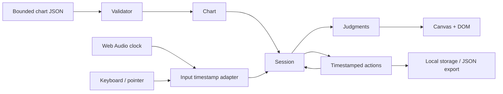

# Architecture

The application is a static browser program. TypeScript is its sole development dependency; production has no JavaScript package dependency. This keeps the timing engine inspectable and the deployment inexpensive.

## Time and determinism

Charts use half-beat positions. The conversion is `(beat + 4) × 60000 / BPM`; the four-beat lead-in is part of the timeline. Input uses `audio clock − input offset`. Rendering follows the raw audio clock so changing the input offset changes judgment timing rather than the chart's visual/audio alignment.

`Session` accepts monotonically increasing timestamps. It does not access the DOM, audio devices, wall-clock dates or network. Repeated press events in a down lane do nothing. Chord notes are independent lane events at the same timestamp. Each note has `waiting`, `holding` or `done` state.

`advance` gathers overdue heads and completed holds, sorts deadlines by time and stable note index, and applies them in that order. A large frame gap therefore preserves the same judgment ordering as small updates. Misses use a strict `time > deadline` comparison so an input at the inclusive 140 ms boundary remains eligible. Hold completion uses `time >= tail`, and an early release is judged against the separate 60 ms grace interval.

Scores are derived by folding the judgment stream. The design deliberately avoids multiplier dependencies; this makes the score and weighted accuracy easy to independently verify. `replay` feeds the saved actions through a fresh session, then resolves unplayed notes as misses. Local files are evidence for investigation, not trusted proof of skill: they can be edited.

## Audio and scheduling

`PulseAudio` uses Web Audio oscillators, not audio files. The clock reads `AudioContext.currentTime`; pulses are scheduled up to 180 ms ahead. Closing a run closes its context and pending sound. Suspension freezes audio time during pause. The UI pauses after a frame interruption over one second or when the tab loses visibility. Main-thread load and browser throttling can still disrupt audio scheduling; this is a known limit, not smoothed into invented results.

Calibration records one tap per nearest beat, ignores count-in, and suggests the median after at least four samples. It estimates a user's offset against a particular setup. A calibrated offset should not be interpreted as an objective measure of output latency.

## Data structures and complexity

Charts are sorted arrays of at most 256 notes. A four-element lane-end array validates non-overlap in linear time after sorting. A set tracks down lanes. Note lookup and deadline collection are linear scans; deadline sorting is `O(n log n)` in the worst frame. At this explicit budget, a heap or interval tree would add complexity without measurable benefit. Editor DOM is capped at 512 cells.

Saved history is bounded to 12 runs. Imports are capped before JSON parsing and validated again before gameplay. Strings enter the page through `textContent`, not `innerHTML`. Unknown fields are discarded by chart validation. Charts contain no executable snippets, remote assets or HTML.

## Deliberate omissions

No backend, multiplayer, paid songs, real money, authentication, upload service or leaderboard is needed for the timing problem. Adding them would expand the security and operating burden while weakening reproducibility. A future experiment could add Web MIDI input or audio-worklet scheduling, with measured device behavior and dedicated tests.
